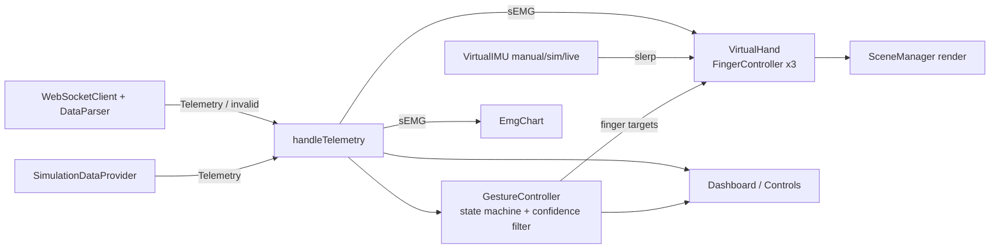

# Nuada Virtual Bionic Hand — Three.js + TypeScript simulation

A **fully virtual**, browser-only simulation of a three-finger bionic hand (thumb, index, middle).
It visualises gesture classification, sEMG (4 channels), IMU orientation and TinyML latency in the style of the
[nuada-bionic-hand-tinyml](https://github.com/nziyak/nuada-bionic-hand-tinyml) digital-twin concept.

> **No hardware is controlled or modelled.** There is no real arm, servo, motor, motor driver, actuator, tendon, cable,
> electronics board, physical sEMG band or physical sensor. All data only moves the 3D model and the UI.

## Run

```bash
npm install
npm run dev        # http://localhost:5173
npm run build      # type-check + production build
```

Optional fake ESP32-S3 telemetry server for **Live Data Mode** (pure software, sends JSON text only):

```bash
npm run mock:ws                  # ws://localhost:8080
npm run mock:ws -- --corrupt     # also emits broken packets to test safe behaviour
```
Then choose **Live Data Mode** in the panel and press **Connect**.

## File structure

```text
src/
├── main.ts                      App wiring, main loop, watchdog, safe behaviour
├── scene/
│   ├── SceneManager.ts          Renderer, scene, lab grid backdrop, resize
│   ├── CameraManager.ts         PerspectiveCamera + OrbitControls + animated reset
│   └── Lighting.ts              Hemisphere / key / rim / fill lights
├── hand/
│   ├── VirtualHand.ts           Hierarchical Object3D hand, joint indicators, angle arcs, GLB binding
│   ├── FingerController.ts      Per-finger smoothing, speed limit, joint angle clamping
│   ├── GestureController.ts     9 gesture profiles + gesture state machine + confidence softening
│   └── JointLimits.ts           Joint min/max angles, speeds, smoothing, IMU limits
├── data/
│   ├── SimulationDataProvider.ts  Fake telemetry: scenario/random gestures, confidence, latency
│   ├── WebSocketClient.ts         Receive-only WebSocket client with reconnect
│   └── DataParser.ts              Strict validation of JSON (never throws)
├── sensors/
│   ├── VirtualEMG.ts            Synthetic 4-channel sEMG envelopes
│   └── VirtualIMU.ts            Virtual MPU-6050 angles, manual override
├── ui/
│   ├── Dashboard.ts             Status/gesture readouts (10 Hz DOM updates) + FPS meter
│   ├── Charts.ts                Canvas sEMG scope
│   └── Controls.ts              Buttons, sliders, keyboard
└── types/telemetry.ts           Gesture, finger, IMU, sEMG, Telemetry types
tools/mock-esp32-server.mjs      Optional fake telemetry WebSocket server
tools/check-pose.ts, check-contact.ts  Headless dev checks for fingertip distances (npx tsx tools/check-contact.ts)
```

## Architecture



### Hand hierarchy
Joints are nested (each inherits its parent's rotation) and each can be rotated independently:

```text
VirtualHand
├── Palm
├── Thumb → ThumbBase → ThumbJoint → ThumbTip
├── IndexFinger → IndexMCP → IndexPIP → IndexDIP → IndexTip
└── MiddleFinger → MiddleMCP → MiddlePIP → MiddleDIP → MiddleTip
```
Every finger has a normalised flexion (0 = extended, 1 = flexed) mapped to per-joint angles inside the limits in
`JointLimits.ts` (min/max angle, max speed, smoothing coefficient). Motion uses exponential smoothing with a speed
limit; the hand orientation uses `Quaternion.slerp`.

### Gesture state machine
`holding → transitioning → holding`, and any state → `safe` (Rest pose) on invalid / stale data or operator request.
A new gesture must persist ≥ 90 ms with confidence ≥ 0.45. Confidence below 0.85 scales down how far and how fast
targets move; below 0.2 the packet is ignored for motion.

### Safe behaviour
| Situation | Reaction |
|---|---|
| Invalid / corrupt / out-of-range JSON | Rejected, Rest pose, packet ignored for 1.5 s |
| No packet for 1 s (Live mode) | Safe Rest pose (`SAFE · STALE DATA`) |
| Low confidence | Softer, slower motion |
| Any angle | Clamped to virtual joint limits |
| **Safe Position** button | Rest pose + neutral IMU, data ignored until Reset Hand / gesture / mode change |

## Live data format
```json
{
  "timestamp": 1712345678, "gesture": "pinch", "confidence": 0.94,
  "thumb": 0.85, "index": 0.90, "middle": 0.35,
  "pitch": 18.5, "roll": -7.2, "yaw": 2.4,
  "emg": [0.12, 0.34, 0.56, 0.21], "inference_latency_ms": 32
}
```
- `gesture` (required): `rest`, `open`/`open_hand`, `power`/`power_grasp`, `fist`, `pinch`/`pinch_grasp`,
  `point`/`pointing`, `partial`/`partial_grasp`, `thumb_index(_contact)`, `thumb_middle(_contact)`.
- `confidence` (required, 0..1); `thumb`/`index`/`middle` optional flexion 0..1 (default: gesture pose).
- `pitch`/`roll`/`yaw` in degrees (clamped), `emg` exactly 4 values, `inference_latency_ms` optional.
- Roll > 0 is shown as pronation, < 0 as supination.

## Controls
- Gesture buttons, per-finger sliders (**Manual finger control**), IMU sliders (**Manual IMU override**).
- Keys: `W/S` pitch, `A/D` yaw, `Q/E` supination/pronation, `R` reset IMU, `Space` pause.
- **Inject bad packet** demonstrates the safe reaction to corrupt data.
- Mouse: orbit / zoom / pan (OrbitControls); **Reset Camera** animates back.

## GLB models
**Load GLB rig** (or `?model=/path/hand.glb`) binds a GLB if it contains nodes named
`ThumbBase, ThumbJoint, ThumbTip, IndexMCP, IndexPIP, IndexDIP, MiddleMCP, MiddlePIP, MiddleDIP`.
Their rest orientation is kept and flexion is applied on top, with the same limits. Missing nodes → model ignored.

## Performance notes
Shared geometries, no per-frame allocations in the hot path, DOM updates throttled to 10 Hz, chart redraw ≤ 30 Hz,
pixel ratio capped at 2, delta-time clamped. Frame rate is bound by the display refresh (typically 60 FPS).


