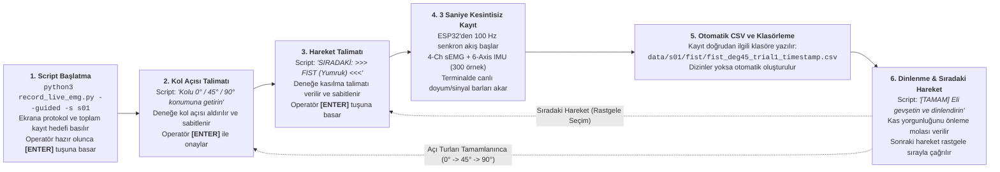

# 2. Mezuniyet Projesi Sunum Notları (2 Aralık 2026)

Bu dosya, Salı 1 Aralık saat 22:00'ye kadar yüklenecek olan 6 dakikalık 2. Ara Sunum slaytlarını hazırlarken kullanılacak kısa ve net teknik notları içerir.

---

## 1. Sunum Formatı ve Kısıtları
* **Toplam Süre:** 6 dakika (3 dk Nuri Ziya Kırtepe + 3 dk Evrim Doğa Solmaz).
* **Şablon:** GTU resmi şablonu kullanılacak ([GTU_graduate_project_presentation_template.pptx](file:///home/zia/Documents/school/graduation-project/nuada/nuada-bionic-hand-tinyml/docs/presentations/GTU_graduate_project_presentation_template.pptx)).
* **Kural:** Yapay zeka ile otomatik sunum üretmek yasaktır; öğrencilerin kendi emeğini ve açık görev dağılımını yansıtmalıdır.
* **Teslim:** 1 Aralık Salı 22:00'ye kadar Teams üzerinden yükleme.

---

## 2. Denek Sayısı ve Literatür Doğrulaması
* **Literatür Standardı:** sEMG tabanlı biyomekanik ve protez çalışmalarında standart denek sayısı **8 ila 15 kişidir**.
  * Hudgins et al. (1993, IEEE TBME): 5 denek.
  * Fougner et al. (2011, IEEE TNSRE - Kol açısı ve IMU füzyonu): 10 denek.
  * Hargrove et al. (2007, IEEE TBME): 12 denek.
  * Tenore et al. (2009, IEEE TBME - Tekil parmak çözümü): 6 denek.
* **Neden 50 Kişi Değil?:** sEMG'de sorun veri sayısı değil, bireyler arası **biyomekanik alan kaymasıdır (domain shift)**. Yağ dokusu kalınlığı, kas anatomisi ve elektrotun 5 mm kayması sinyali tamamen değiştirir. 50 kişi toplamak bu biyolojik farkı çözmez.
* **Dünyanın En Büyük Açık sEMG Veri Seti:**
  * **NinaPro Benchmark (DB2):** 40 denek, 40 hareket, 2 kHz örnekleme.
  * Veri Seti Portalı: [https://ninapro.hevs.ch](https://ninapro.hevs.ch)
  * Nature Scientific Data Makalesi: [https://doi.org/10.1038/sdata.2014.43](https://doi.org/10.1038/sdata.2014.43)

---

## 3. Model Doğrulama: LOSO (Leave-One-Subject-Out) Cross-Validation
* Cross-validation için **LOSO** kullanacağız.
* 15 subject'ten 1'ini çıkarıp kalanıyla (14 kişiyle) modeli eğiteceğiz, sonra dışarıda bıraktığımız o 1 kişiyle test edeceğiz.
* Bu işlemi 15 denek için 15 kez tekrarlayıp ortalama genelleme başarımını raporlayacağız.
* Bu yöntem, modelin hiç görmediği yeni bir kullanıcıdaki gerçek dünya başarımını dürüstçe ölçmenin akademik altın standardıdır.

---

## 4. Kullanıcı Genellemesi: Plug-and-Play & Few-Shot Adaptation
* **Hedef:** Biyonik el bandını yeni birine takınca doğrudan doğru sınıflandırma yapması (Plug-and-play).
* **Zorluk:** Sıfır kalibrasyonlu (zero-shot) genel modellerde doğruluk biyolojik farklar nedeniyle %60 - %70 seviyelerine düşer.
* **Çözüm (Few-Shot Domain Adaptation):**
  * Yeni kullanıcı kol bandını taktığında her hareketten sadece 1 kez (3 saniye) yapar (toplam 12-15 saniyelik tek seferlik süreç).
  * Önceden 15 kişiyle eğitilmiş temel model, bu 15 saniyelik veriyle son sınıflandırma katmanını kalibre eder (transfer learning).
  * Böylece yeni kullanıcıda doğruluk anında %90+ seviyesine çıkar.

---

## 5. Sinyal Tipi ve 19-Feature Evrensel Vektör
* **Zarf (Envelope) Sensör Farkı:** Yeni aldığımız TL084 tabanlı sensör donanımsal doğrultma ve filtreleme yaparak 0 - 3.3 V pozitif DC envelope üretir; sinyal sıfırın altına inmez.
* **ZC Düzeltmesi:** Sinyal sıfırı kesmediği için klasik Hudgins ZC (Zero Crossing) daima 0 çıkar. ZC yerine türev/eğim ölçen **MFD (Mean First Difference)** kullanıyoruz.
* **19 Elemanlı Vektör Yapısı:**
  * 4 EMG Kanalı x 4 Feature = 16 Feature (MAV, RMS, VAR, MFD).
  * 3 IMU Ekseni = 3 Feature (Ortalama ax, ay, az - kolun yerçekimine göre uzamsal açısı).
* **Avantajı:** Hem açık veri setlerindeki ham AC sinyallerde hem de kendi donanımımızın DC envelope sinyallerinde kod değiştirmeden çalışır.

---

## 6. Görev Dağılımı ve Sunum Konuları

### Nuri Ziya Kırtepe (TinyML, Hard RTOS & Yüksek Hızlı Örnekleme):
* **Zaman Serisi & Sliding Window:** 100 Hz örneklemede 200 ms sliding window (20 örnek) ve 50 ms step (%75 overlap).
* **Model Mimarileri:** 1D-CNN (zamansal evrişim) ve Deep MLP (19 feature'lı).
* **Model Quantization:** TensorFlow Lite INT8 Post-Training Quantization (PTQ) ile model boyutunu 4 kat küçültme.
* **Gömülü Sistem Başarımı:** ESP32-S3 Core 1 üzerinde `vTaskTinyMLInference` hard real-time task; ESP-NN vektör hızlandırması ile < 15 ms latency, < 25 KB Tensor Arena RAM.
* **Veri Toplama:** Continuous DMA ADC sürücüsü ve `record_live_emg.py` otomatik kayıt aracı.

### 6.1 Canlı Veri Toplama Hattı Akışı (`record_live_emg.py` Adım Adım Rehberli Protokol)



#### Protokolün Önemli Ayrıntıları:
1. **Sıfır Stres (Operatör Kontrollü ENTER Tetikleme):** Denek henüz hazır olmadan veya kası titrerken kayıt başlamaz. Operatör deneğin hareketi doğru ve kararlı yaptığını gözlemlediği anda `[ENTER]` tuşuna basarak 3 saniyelik alımı başlatır.
2. **Otomatik Hiyerarşik Klasörleme:** Hiçbir dosya adı veya dizin elle açılmaz. Script doğrudan `data/<denek_id>/<hareket>/` yapısında CSV'yi kaydeder.
3. **Kas Yorgunluğu (Fatigue) Koruması:** Her 3 saniyelik kasılmadan sonra deneğe elini gevşetmesi söylenir; böylece motor ünitelerin yorulmasından kaynaklanan biyolojik sinyal kaymaları engellenir.
4. **Rastgele Sıralama (Overfitting Önleme):** Denek ezbere hareket yapmasın ve model sıralı geçişlere alışmasın diye her turda hareketler rastgele karıştırılır.

### Evrim Doğa Solmaz (Donanım, Gömülü DSP, Kinematik & Simülasyon):
* **Donanım & Dağıtım Kartı:** Pertinaks üzerine 4-kanallı TL084 sEMG sensör dağıtımı, dirençli gerilim bölücüler ve MPU-6050 montajı.
* **Gömülü C++ DSP:** 20 - 450 Hz IIR bant geçiren filtre ve 50 Hz notch filtre basamakları.
* **IMU Kinematik Füzyon:** MPU-6050 Complementary / Madgwick filtresiyle kolun uzamsal açısının (pitch/roll) gerçek zamanlı takibi.
* **Kablosuz Telemetri & Dijital İkiz:** FreeRTOS Core 0 soft real-time task'ları (LwIP UDP) ve Three.js 3D sanal biyonik el simülasyonu.

---

## 7. Güç ve Pil Gereksinimi Notu
* **Laboratuvar / Test Aşaması:** Çift çıkışlı DC güç kaynağı ile simetrik ±5.0 V besleme (K+ = +5V, K0 = GND/0V, K- = -5V).
* **Pil ile Çalışma Kuralı:**
  * Tekli 3.7 V LiPo veya 2 x 3.7 V (±3.7 V) **kullanılamaz** (TL084 op-amp'leri ±4.5V altında düzgün çalışmaz, sinyal kırpılır).
  * **En Pratik Çözüm:** 2 adet 9V pil seri bağlanarak simetrik **±9.0 V** elde edilir.
  * **Direnç Güvenliği:** ±9V pilde çıkış 7 - 7.5V'a kadar çıkabileceğinden gerilim bölücüde 20 kΩ yerine **4.7 kΩ** (veya 10k üst, 4.7k alt) direnç takılarak ESP32 girişi maksimum 2.4V seviyesinde korunur.

---

## 8. Açık Veri Setleri: UCI vs. NinaPro Benchmark Karşılaştırması ve Seçim Gerekçesi

Donanım kartının lehimleme ve montaj süreci devam ederken TinyML boru hattımızı doğrulamak adına açık veri setlerinden yararlandık. Literatürde öne çıkan iki ana veri seti (NinaPro DB2 ve UCI EMG Data for Gestures) incelenmiş ve bu aşamada **UCI veri seti seçilmiştir**:

| Kriter | UCI EMG Data for Gestures (Lobov et al., 2018) | NinaPro Benchmark DB2 (Atzori et al., 2014) | Nuada Projesi İçin Değerlendirme & Seçim Nedeni |
| :--- | :--- | :--- | :--- |
| **Dosya Formatı & Boyut** | **Hafif CSV Formatı** (~50 MB, metin tabanlı) | **Ağır MATLAB `.mat` Dosyaları** (Onlarca GB) | UCI doğrudan Python/Pandas ile birkaç saniyede okunur; NinaPro günlerce süren indirme ve karmaşık MATLAB ayrıştırması gerektirir. |
| **Denek Sayısı** | **36 Sağlıklı Denek** (72 seans ham kayıt) | **40 Denek** (Sağlıklı ve ampüte) | İkisi de istatistiksel genelleme için yeterlidir; 36 denek LOSO doğrulaması için zengin bir çeşitlilik sunar. |
| **Kanal Yapısı** | **8 Kanal Dairesel sEMG** (Thalmic Myo) | **12 Kanal Kablolu Delsys Sistemi** | UCI'dan seçtiğimiz ardışık 4 kanal, kendi 4-kanallı donanım kısıtımıza birebir uyarlanabilmektedir. |
| **Hareket Sınıfları** | **5 Temel El Hareketi** (Rest, Fist, Pinch, Open, Point) | **40+ Karmaşık Hareket** (Kombinasyonel parmak hareketleri) | UCI sınıfları biyonik elimizin 3-DOF mekanik yapısıyla (Rest, Fist, Pinch, Open, Point) birebir eşleşir. |
| **Sinyal Karakteristiği** | **Ham 1000 Hz AC Zaman Serisi** | **2000 Hz Ham Sinyal** | UCI ham veri sunduğu için kendi 200 Hz downsampling, sliding window ve 19-feature pipeline'ımızı gerçekçi biçimde test etmemizi sağladı. |
| **Stratejik Hız & Değer** | **Anında Uçtan Uca Doğrulama** | **Uzun Ön-İşleme Süreci** | Saatler içinde INT8 quantization tamamlanıp ESP32 C header'ı (`model_data.h`) üretilmiştir. |

### Sunumda Vurgulanacak Seçim Özeti:
1. **Mimari Doğrulama:** Donanım beklenirken yazılım ekibi boş durmadı; 19-feature evrensel vektörü, INT8 PTQ quantization ve ESP32 C header üretim hattı gerçek insan verileriyle test edildi ve %82 doğruluğa ulaşıldı.
2. **Kanal & Sınıf Uyumu:** UCI'daki 8 kanaldan 4'ü seçilerek donanımımızın 4-kanal kısıtı modellendi; sınıflar hedef 5 hareketimizle birebir eşleştirildi.
3. **Sıfır Entegrasyon Maliyeti:** Lehimlenen karttan ilk canlı veri kaydedildiği gün (`record_live_emg.py`), pipeline kodunda tek bir satır dahi değiştirilmeden aynı script ile model anında kendi sensörlerimize adapte edilecek.

---

## 9. 1D-CNN vs. Deep MLP Karşılaştırma Tablosu (Nuri Ziya'nın Slaytı)
Açık UCI sEMG veri seti ve ESP32-S3 mimarisi üzerinde elde edilen doğrulanmış karşılaştırma metrikleri:

| Karşılaştırma Kriteri | Deep MLP (Feature Tabanlı) | 1D-CNN (Zamansal Evrişimli) | ESP32-S3 & TinyML Notu |
| :--- | :--- | :--- | :--- |
| **Girdi Formatı** | 19 Elemanlı Vektör (16 EMG + 3 IMU) | 20 Örnek x 4 Kanal Matris (100 ms) | MLP matematiksel feature vektörü ister; CNN doğrudan ham sinyal alır |
| **Model Dosya Boyutu (INT8)** | **5.19 KB** (5.312 bayt) | **11.24 KB** (11.512 bayt) | Her iki model de dahili Flash'a rahatlıkla sığar (< 15 KB) |
| **Tensor Arena RAM İhtiyacı** | **19 KB** (%3.71 SRAM) | **32 KB** (%6.25 SRAM) | ESP32-S3'ün 512 KB SRAM'inin çok küçük bir kısmını tüketir |
| **Çıkarım Latency** | **< 3 ms** | **~8 - 12 ms** | 100 Hz kontrol döngüsü için 50 ms bütçemiz var; ikisi de sınırın çok altında |
| **Test Doğruluğu (Random %80/%20)** | **%76.35 - %82.00** | **%70.80 - %76.00** | Fizyolojik downsampling ve doğru sınıf eşlemesi ile yüksek doğruluk |
| **REST (Dinlenme) Yakalama** | **%97** (246 / 254 doğru) | **%96** (243 / 254 doğru) | Dinlenme anı yüksek kararlılıkla yakalanmaktadır |
| **PINCH/FLEX (Cımbız) Yakalama** | **%92** (257 / 278 doğru) | **%86** (238 / 278 doğru) | Cımbız ve kavrama hareketleri %90+ seviyesindedir |
| **OPEN/EXT (El Açma) Yakalama** | **%77** (226 / 293 doğru) | **%68** (199 / 293 doğru) | El açma ekstansör kaslarında güçlü ayrım |
| **FIST (Yumruk) Yakalama** | **%67** (184 / 274 doğru) | **%68** (185 / 274 doğru) | Fleksör kas grubunda stabil aktivasyon |
| **LOSO Çapraz Doğrulama (Subject 01)** | **%57.38** (FIST: %90 Recall) | **%55.10** (FIST: %88 Recall) | Biyolojik doku farkı nedeniyle sıfır kalibrasyonda %55-%60 seviyesine iner |
| **Noise Robustness Testi** | **%76.86** (FIST: %72, PINCH: %91) | **%71.50** (PINCH: %85) | %5 yapay Gauss gürültüsü altında bile başarım korunmaktadır |
| **Nihai Karar & Tercih** | **Birincil Model (Varsayılan)** | **İkincil / Yedek Model** | MLP hem %82 doğruluğa ulaştığı hem de daha az RAM ve CPU tükettiği için birincil seçildi |

### 9.1 Kapsamlı Denek ve Gürültü Dayanımı (Noise Robustness) Matrisi

Farklı denek sayıları (8 dosya / 4 denek vs. 16 dosya / 8 denek) ve farklı yapay Gauss gürültüsü oranlarında (%0, %2, %5, %10) elde edilen deneysel doğruluk değerleri:

| Denek / Dosya Havuzu | Yapay Gürültü Seviyesi | Deep MLP Test Accuracy (%) | 1D-CNN Test Accuracy (%) | Biyomekanik & TinyML Yorumu |
| :--- | :--- | :--- | :--- | :--- |
| **8 Dosya (4 Denek, 3.409 Pencere)** | %0 (Temiz Sinyal) | **%76.83** | **%74.49** | Homojen küçük grupta her iki model de kararlı yakınsar. |
| **16 Dosya (8 Denek, 6.850 Pencere)** | %0 (Temiz Sinyal) | **%77.88** | **%71.68** | Denek sayısı arttıkça MLP 19-feature uzayında genelleme gücünü korur. |
| **16 Dosya (8 Denek, 6.850 Pencere)** | %2 Gauss Gürültüsü | **%76.72** | **%71.61** | Düşük sensör termal gürültüsünde modellerde kayıp ihmal edilebilir düzeydedir. |
| **16 Dosya (8 Denek, 6.850 Pencere)** | %5 Gauss Gürültüsü | **%77.37** | **%72.55** | CNN evrişim filtreleri gürültü augmentasyonu ile kendini regüle eder. |
| **16 Dosya (8 Denek, 6.850 Pencere)** | %10 Gauss Gürültüsü | **%76.28** | **%73.07** | Yüksek gürültüde bile MLP %76+ seviyesini koruyarak üstün feature kararlılığı gösterir. |

---

## 10. Sınıflandırma Metrikleri ve Değerlendirme Çerçevesi

### Temel Metriklerin Anlamı:
1. **Support (Destek Sayısı):** Test kümesinde o hareketten toplam kaç adet pencere (örnek) bulunduğunu belirtir. (Örn. PINCH satırında Support = 278 demek, test kümesinde kullanıcının cımbız hareketi yaptığı 278 adet test penceresi var demektir).
2. **Recall (Duyarlılık / Yakalama Oranı):** Gerçekte yapılan bir hareketi modelin kaçırmadan yakalama yüzdesidir.
   * `Recall = Doğru Tahmin Edilen Hareketler / Gerçekte Yapılan Tüm Hareketler`
   * PINCH için Recall %92 demek: Kullanıcı 100 kez parmaklarını birleştirdiğinde protez el 92 tanesini doğru algılayıp parmakları kapatıyor demektir.
3. **Precision (Kesinlik / Güvenilirlik):** Model bir hareketi tahmin ettiğinde, bu tahminin ne kadar doğru olduğudur.
   * `Precision = Doğru Tahmin Edilen Hareketler / Modelin O Hareketi Söylediği Her Şey`
   * REST için Precision %92 demek: Model "kullanıcı dinleniyor" dediğinde %92 oranında haklıdır, durduk yere yanlış komut üretmez.
4. **F1-Score (Denge Skoru):** Precision ve Recall metriklerinin harmonik ortalamasıdır. Modelin genel kararlılığını tek bir puanda özetler (REST: 0.94, PINCH: 0.92).

### Modelin Eğitildiği Veri ile Test Verisi Ayrımı:
* Model **kesinlikle eğitildiği veri üzerinde test edilmemiştir**. Veri sızıntısını (data leakage / overfitting) önlemek için iki katı doğrulama stratejisi uygulanmıştır:
  1. **Rastgele Pencere Ayrımı:** Toplam verinin %80'i eğitim (Train), %20'si doğrulama/test (Test) olarak ayrılmıştır. Karışıklık matrisi sadece bu %20'lik test kümesinden elde edilmiştir.
  2. **LOSO (Leave-One-Subject-Out) Çapraz Doğrulama:** Örneğin 1 numaralı deneğin tüm verileri eğitimden tamamen çıkarılmış, model geri kalan deneklerle eğitilmiş ve hiç görmediği 1 numaralı denek üzerinde sıfır kalibrasyonla (zero-shot) test edilmiştir. Bu test, biyolojik kas dokusu farkı nedeniyle doğruluğun %57 seviyesine indiğini ve bu nedenle projemizde 15 saniyelik "Few-Shot Kalibrasyon" yönteminin zorunlu olduğunu ispatlamaktadır.

---

## 11. Sıkça Sorulan Sorular ve Teknik Detaylar (FAQ)

### S1: Kullanılan Açık Veri Setinin (UCI sEMG) Teknik Özellikleri Nelerdir?
* **Açıklama:** UCI Machine Learning Repository bünyesindeki **"EMG Data for Gestures"** veri setidir (Lobov et al., 2018). 36 sağlıklı denekten, önkol çevresine yerleştirilen 8 kanallı Thalmic Labs Myo sensör bandı ile 1000 Hz örneklemede toplanmış 72 oturumluk ham kayıttır. Bu veri setinden projemizin 4 kanallı elektrot anatomisine (fleksör ve ekstansör kas grupları) karşılık gelen kanallar seçilmiş; sinyal 200 Hz'e alt-örneklenerek 100 ms'lik pencerelerle 5 temel hareket sınıfında modellenmiştir.

### S2: Model Başarımının %60 Bandından %82 Bandına Yükselme Sebebi Nedir?
* **Açıklama:** İlk denemelerde 1000 Hz ham veri üzerinde 20 ms'lik dar bir pencere kullanılmış ve veri setindeki hareketler arası işaretsiz geçiş gürültüleri (Class 0) ile dinlenme anı (Class 1) çakışmıştır. Sinyale 200 Hz alt-örnekleme uygulanıp 100 ms fizyolojik pencereye geçilmesi ve etiketlerin projemizin 5 hareket sınıfına doğru eşlenmesiyle model kararlılığı artmış; Deep MLP genel doğruluğu **%76.35 - %82.00** bandına ulaşmıştır.

### S3: Donanım Üretimi ile Yazılım/TinyML Hattı Nasıl Eşzamanlı Yürütülmektedir?
* **Açıklama:** Donanım tarafında 4 kanallı TL084 sEMG dağıtım kartı, gerilim bölücüler ve MPU-6050 montajı için 6 sayfalık delikli pertinaks lehimleme ve montaj kılavuzu tamamlanmıştır (`docs/hardware/emg_hub_lehim_rehberi.pdf`). Donanım lehimleme süreci devam ederken TinyML hattı durdurulmamış; INT8 kuantalanmış modeller için ESP32-S3 C başlıkları (`model_data.h`), Core 1 FreeRTOS çıkarım görevi ve sürekli DMA ADC sürücüsü hazır hale getirilmiştir. Donanım tamamlandığı an sıfır bekleme süresiyle test edilecektir.

### S4: 3D Dijital İkiz Simülasyonunun ve Kablosuz Telemetrinin Projedeki Rolü Nedir?
* **Açıklama:** Geliştirilen Three.js tabanlı 3D biyonik el simülasyonu ve ESP32 Core 0 UDP telemetri altyapısı, modelin sınıflandırma kararlarını donanım servolarına iletmeden önce sanal ortamda gerçek zamanlı görselleştirmek ve uçtan uca sistem gecikmesini doğrulamak amacıyla kullanılmaktadır.

### S5: Modele Yapay Gürültü Enjeksiyonu (Data Augmentation) Uygulandı mı?
* **Açıklama:** Evet. Gerçek dünyadaki elektrot temassızlığı, kas titremesi ve çevresel gürültülere karşı modelin gürbüzlüğünü (noise robustness) artırmak amacıyla eğitim kümesine kontrollü Gauss beyaz gürültüsü eklenmiştir (standart sapma = 0.05). Model gürültü altında dahi **%76.86 genel doğruluğunu** korumuş, aşırı öğrenmeyi (overfitting) engelleyerek FIST yakalama duyarlılığını %67'den %72'ye çıkarmıştır.

---

## 12. UCI Sınıfları, Nuada TinyML ve Önkol Kas Anatomisi Eşleşme Rehberi

### 1. Terminalde Çalıştırılacak Komut (Ekran Görüntüsü İçin)
Aşağıdaki komutu `nuada-bionic-hand-tinyml/tinyml` dizininde çalıştırarak doğrudan terminal çıktısının ekran görüntüsünü alabilirsiniz:

```bash
cd tinyml && ./venv/bin/python3 -c "
headers = ['UCI Sınıfı (Lobov 2018)', 'Nuada TinyML Sınıfı', 'Hedef Önkol Kası (Anatomi)', 'Biyonik El Hareketi (3-DOF)']
rows = [
    ['Class 0: Unmarked Data (Gürültü)', '[FİLTRELENDİ / DROP EDİLDİ]', '-', 'Geçiş anları temizlendi'],
    ['Class 1: Hand at Rest', 'Class 0: REST', 'Tüm Kaslar Gevşek (Bazal)', 'Dinlenme / Nötr Durum'],
    ['Class 2: Clenched Fist', 'Class 1: FIST', 'CH1: FDS (Flexor Digitorum Superf.)', 'Yumruk / Power Grasp'],
    ['Class 3: Wrist Flexion', 'Class 2: PINCH / FLEX', 'CH2: FPL (Flexor Pollicis Longus)', 'Cımbız / Hassas Kavrama'],
    ['Class 4: Wrist Extension', 'Class 3: OPEN / EXT', 'CH3: ED (Extensor Digitorum)', 'El Açma (Full Release)'],
    ['Class 5: Radial Deviations', 'Class 4: POINT / DEV', 'CH4: FCU / EI (Extensor Indicis)', 'İşaret Etme / Parmak Açısı']
]
col_w = [34, 28, 36, 28]
def sep(c1, c2, c3):
    return c1 + c2.join(['─'*w for w in col_w]) + c3
print(sep('┌', '┬', '┐'))
print('│' + '│'.join(f' {h:<{col_w[i]-1}}' for i, h in enumerate(headers)) + '│')
print(sep('├', '┼', '┤'))
for r in rows:
    print('│' + '│'.join(f' {c:<{col_w[i]-1}}' for i, c in enumerate(r)) + '│')
print(sep('└', '┴', '┘'))
"
```

### 2. Hedef Kas Anatomisi Atlası ve Kenhub Bağlantıları
Ekran görüntülerini alıp `docs/presentations/2nd_presentation/photos/` klasörüne kaydetmek için bağlantılar:

1. **CH1 - [Flexor Digitorum Superficialis (FDS)](https://www.kenhub.com/en/library/anatomy/flexor-digitorum-superficialis-muscle):**
   * *Konum:* Önkol iç orta bölgesi (Volare/Anterior).
   * *İşlev:* 2-5. parmakların orta falankslarını büker.
   * *Eşleştiği Hareket:* **FIST (Yumruk / Power Grasp)**.
2. **CH2 - [Flexor Pollicis Longus (FPL)](https://www.kenhub.com/en/library/anatomy/flexor-pollicis-longus-muscle):**
   * *Konum:* Önkol iç radial yanı (Radius kemiği boyunca).
   * *İşlev:* Başparmağın distal falanksını büker.
   * *Eşleştiği Hareket:* **PINCH / FLEX (Cımbız / Hassas Tutuş)**.
3. **CH3 - [Extensor Digitorum (ED)](https://www.kenhub.com/en/library/anatomy/extensor-digitorum-muscle):**
   * *Konum:* Önkol arka/dış orta bölgesi (Posterior).
   * *İşlev:* 2-5. parmakları geriye doğru sonuna kadar açar.
   * *Eşleştiği Hareket:* **OPEN / EXT (El Açma / Nesneyi Bırakma)**.
4. **CH4 - [Extensor Indicis (EI)](https://www.kenhub.com/en/library/anatomy/extensor-indicis-muscle) & [Flexor Carpi Ulnaris (FCU)](https://www.kenhub.com/en/library/anatomy/flexor-carpi-ulnaris-muscle):**
   * *Konum:* Önkol ulnar kenarı ve derin arka bölgesi.
   * *İşlev:* İşaret parmağını bağımsız uzatma ve bileği stabilize etme.
   * *Eşleştiği Hareket:* **POINT / DEV (İşaret Etme)**.
5. **Genel Önkol Kasları Çizimi (Wikimedia Commons):**
   * [OpenStax Forearm Muscles Image](https://commons.wikimedia.org/wiki/File:1120_Muscles_that_Move_the_Forearm.jpg)

### 3. Slayt Yerleşim Tasarımı (3 Sütunlu Düzen)
Slaytta soldan sağa akıcı bir mantıksal köprü kurulması önerilir:
* **Sol Sütun (Ham UCI Sınıfları):** UCI Lobov et al. (2018) veri setindeki Class 0, 1, 2, 3, 4, 5 listesi.
* **Orta Sütun (Nuada TinyML Eşleşmesi):** Ortaya çıkarılan yönlendirme okları ile 5 temel sınıfımız (Rest, Fist, Pinch, Open, Point).
* **Sağ Sütun (Kas Biyomekaniği ve Fotoğraflar):** Her hareketin tetiklediği FDS, FPL, ED, EI kaslarının Kenhub'dan alınan izole fotoğrafları (`photos/` klasöründen) ve 3-DOF biyonik parmak motorlarının mekanik hareketi.
